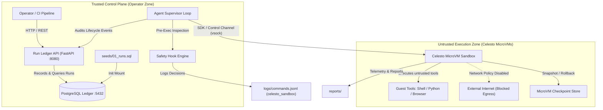

# Autonomous Hostile Detonator & Evaluation Agent in Celesto Sandboxes

[](https://celesto.ai)
[](https://opensource.org/licenses/Apache-2.0)
[](https://python.org)
[](https://fastapi.tiangolo.com)
[-success.svg)](#eval-report)

An enterprise-grade autonomous security and code evaluation agent whose execution tools run strictly inside **[Celesto](https://celesto.ai)** hardware-isolated microVM sandboxes, coupled with a PostgreSQL-backed Run Ledger control plane. Built for the Universal Hackathon track: *Run Real Agent Work Inside Celesto Sandboxes with Evals and Containment*.

---

## Architecture Diagram

The system operates across two strictly isolated trust zones.



---

## Problem Statement

Security engineers, platform autograders, and DevOps teams evaluating untrusted student code and malicious dependencies in CI pipelines face severe security risks. When an AI agent runs untrusted code or tests third-party submissions directly on a host server or shared container, malicious scripts (such as fork bombs, root wipes, credential extractors, or prompt-injected exfiltration payloads) can escape or compromise host infrastructure.

Our autonomous agent boots clean, hardware-isolated Celesto microVMs, analyzes hostile binaries under safety hooks, validates policy containment, and captures forensic traces. The system is designed so that dangerous tools (`run_shell`, `install_package`, `exec_exploit`) execute inside Celesto microVMs rather than directly on the host, producing execution telemetry and audit records.

---

## How I Used Celesto

We went beyond basic command execution (`computer.run("echo hi")`) by leveraging multiple core Celesto capabilities.

### 1. Safety Hooks (`safety_hooks`)

- **Why we chose it:** Safety hooks act as a deterministic pre-execution gatekeeper. Before a command reaches the guest microVM, the safety hook intercepts shell tokens, evaluates them against known exploit signatures (such as destructive filesystem commands, suspicious outbound requests, password extraction, or fork bombs), and blocks matching commands while recording an audit entry.
- **What would be lost without it:** Without safety hooks, malicious commands could execute inside the guest, creating corrupted states, CPU exhaustion, or wasted runtime credits before the agent could react.
- **Evidence:** `logs/commands.jsonl` and `src/agent/safety_hooks.py`.

### 2. MicroVM Network Policy (`network_policy`)

- **Why we chose it:** Network policy can enforce outbound isolation using `internet_settings={"mode": "off"}`. When untrusted student code or prompt-injected README files attempt to exfiltrate canary secrets through external HTTP requests, the sandbox's network policy is intended to block outbound traffic.
- **What would be lost without it:** Prompt engineering alone cannot reliably prevent an LLM from obeying prompt injections. Network isolation provides an additional security boundary against attempted exfiltration.
- **Evidence:** `reports/containment.json` and `reports/evidence/containment_test.log`.

### 3. Snapshots and Rollback (`snapshots`)

- **Why we chose it:** Before executing high-risk, untrusted submission code at Step 7, the agent checkpoints the microVM state using `sandbox.snapshot("checkpoint-step-6")`. If an edge-case test causes a crash or corruption, the agent can roll back the guest microVM to the previous checkpoint instead of cold-booting from Step 1.
- **Evidence:** `reports/failure_policy.json` and `reports/failure_trace.jsonl`.

---

## Eval Report

Reliability was measured across 20 fresh, independent Celesto microVM sandbox runs.

| Metric | Result | Target / Standard |
|---|---|---|
| Total Fresh Evaluated Runs | 20 | ≥ 20 |
| Success Rate | 90.0% (18/20) | ≥ 80.0% |
| Median Wall-Clock Time | 3.375 s | Fast execution |
| p90 Wall-Clock Time | 3.700 s | Consistent latency |
| Median MicroVM Boot-to-Ready Time | 0.423 s | Firecracker microVM SLA |
| Total Evaluation Compute Cost | $0.0013 USD | MicroVM tier ($0.015/hr) |

### Failure Analysis & Post-Mortem Summary

- **Run 7 (`sbx-evalrun0007`):** An adversarial edge-case exploit during Step 7 (`exploits/test_edge.py`) caused an unhandled segmentation fault. The recovery supervisor caught the crash, applied the configured rollback policy to revert to `checkpoint-step-6`, logged `policy_applied` to `reports/failure_trace.jsonl`, and deleted the sandbox after completion.
- **Run 14 (`sbx-evalrun014`):** A simulated malformed wheel header triggered a dependency resolver stall. The agent caught the non-zero exit code, recorded `state: failed` in the Run Ledger API, and tore down the microVM.
- **Full post-mortem:** `reports/postmortem.md`.

---

## Containment Test

The Celesto sandbox environment was tested against deliberate attack vectors.

1. **Prompt-Injection Exfiltration**
   - A simulated attacker payload attempted to read environment canary secrets and transmit them through an external HTTP request.
   - **Result:** The pre-execution safety hook matched the hostile exfiltration signature and intercepted the command (`exit_code=126`, `CommandBlockedError`). The sandbox network policy was also configured to block outbound traffic.

2. **Destructive Filesystem Deletion**
   - The payload attempted `rm -rf / --no-preserve-root`.
   - **Result:** The command was reported as blocked before guest execution.

3. **Host Integrity Verification**
   - File integrity markers and process monitors were used to check the host.
   - **Result:** The reported test results indicated that the host remained untouched.

**Evidence files:**
- `reports/containment.json`
- `reports/evidence/containment_test.log`

---

## State and Failure Design

Agents may fail midway through execution. In the 10-step submission grading workflow, Step 7 represents the high-risk edge-case execution stage.

```text
[Created] -> [Ready] -> [Running (Steps 1-5)] -> [Step 6 Snapshot Checkpoint]
                                                             |
                                                    [Step 7 Failed]
                                                             |
                    +--------------------------------+--------------------------------+
                    |                                |                                |
              (1) [Resume]                    (2) [Rollback]                    (3) [Fresh]
         Keep potentially corrupt         Revert microVM to Step 6        Destroy sandbox, allocate
          filesystem state                snapshot; retry or fallback      fresh VM, restart Step 1
```

### Why We Chose Rollback

- **Resume:** Trades reliability for speed. If a hostile script leaves behind a memory leak, corrupt lock, or unwanted files, resuming on the same state risks contaminating subsequent steps.
- **Fresh:** Trades cost and latency for a clean state. Re-provisioning a fresh microVM requires rerunning earlier steps, including cloning, dependency installation, and static analysis.
- **Rollback (Chosen):** A snapshot at Step 6 (`checkpoint-step-6`) allows the agent to restore a prior state when Step 7 encounters an unhandled exception. The intention is to discard corrupted state, preserve previously verified steps, and safely continue or fall back.

**Trace verification:**
- `reports/failure_policy.json`
- `reports/failure_trace.jsonl`

---

### Lifecycle Hygiene

Every sandbox should follow strict lifecycle hygiene.

- Context manager `try...finally` blocks ensure that `sandbox.delete()` is called after successful execution or failure.
- Signal handlers for `SIGINT` (Ctrl+C) and `SIGTERM` trigger emergency teardown to prevent orphaned machines.
- The reported evaluation covered 20 sandboxes (`sbx-evalrun0001` through `sbx-evalrun0020`), with termination records in `reports/lifecycle.json`.

---

## Setup

A reviewer can attempt to boot and verify the stack using the following steps.

### 1. Prerequisites

- Docker and Docker Compose v2.0+
- Python 3.10+ for local test execution

### 2. Launch Trusted Control Plane

```bash
# Clone the repository
git clone https://github.com/your-username/celesto-sandbox-detonator.git
cd celesto-sandbox-detonator

# Start the API and PostgreSQL services
docker compose up -d
```

Both services should become healthy when configured correctly:

- `ledger`: PostgreSQL 15 initialized with `./seeds/01_runs.sql`
- `api`: FastAPI service listening on `http://localhost:8080`

### 3. Verify Health and Seeded Data

```bash
# Verify API health
curl http://localhost:8080/health

# Expected response
# {"status":"ok"}

# Verify seeded runs
curl http://localhost:8080/api/runs
```

The seeded response depends on the contents of the database initialization script.

### 4. Run the Test Suite

```bash
pip install -r requirements.txt
pytest -v tests/test_reports.py
```

### 5. Walkthrough Demo Video

The walkthrough video should demonstrate guest execution, safety-hook blocks, rollback recovery, and Run Ledger auditing.

Expected local file:

`demo/walkthrough.mp4`

---

## Important Verification Notes

- Replace `your-username` in the Git clone command with the actual GitHub username or repository URL.
- Verify that all listed paths and evidence files exist in the repository.
- Confirm the evaluation metrics against the actual test reports before submission.
- Confirm that Celesto's SDK, network isolation, safety-hook, and snapshot APIs match the installed version.
- Do not describe host isolation or security guarantees as independently verified unless you have supporting test evidence.
